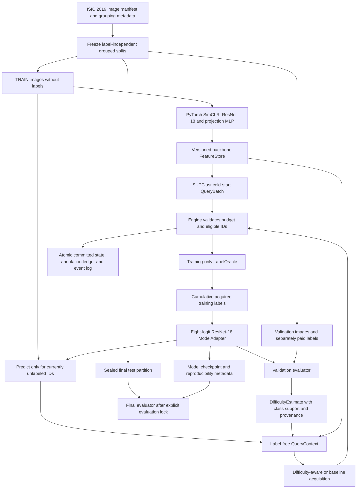

# Architecture specification

> Current implementation status (21 November 2026): Stages B-F were subsequently authorized together and implemented. The Stage A design below records original intent; current APIs and any differences are documented in [MODULE_GUIDE.md](MODULE_GUIDE.md) and the completion report.

Status: implemented through Stages B-F under the user's subsequent authorization. No real ISIC training. Algorithm assumptions below are versioned design decisions; see MODULE_GUIDE.md for exact executable signatures.

## Research objective and source boundaries

CSDA-AL will test whether label-free, boundary-oriented initialization followed by prediction-based difficulty-aware acquisition improves recognition and label efficiency on imbalanced ISIC 2019. This is a research hypothesis, not an established result.

SUPClust provides the initial representation/clustering/typicality/SUP mechanism. Flexible Sampling provides validation class difficulty and uncertainty ideas, but its known-label sampling buckets cannot operate on a genuinely unlabeled pool. Active Label Refinement provides useful strategy and budget-loop precedents; its label-correction objective, Co-teaching and VOG do not enter the primary engine. Google SimCLR is a TensorFlow reference; the integrated software will be original PyTorch code.

The target is an eight-class closed-set study. The official challenge also includes an unseen test category. An eight-logit model must not be reported as a full nine-category challenge solution. The planned primary test is a frozen held-out partition of the official eight-class training collection. External challenge data requires a separately declared known-class evaluation protocol; unknown labels will never be silently mapped into eight classes. See [official challenge description](https://challenge.isic-archive.com/landing/2019/).

## Component and information flow

The selector receives neither the oracle nor the training-label store nor a labeled validation dataset. Only a derived eight-element difficulty vector and its support/provenance summary cross the validation boundary. Training labels are available to the trainer after annotation. Post-annotation diagnostics are computed after committing the query, and cannot alter that query.

## Representation and classifier

ResNet-18 produces 512-dimensional pooled backbone embeddings. SimCLR adds a two-layer projection MLP with a configurable projection dimension. For `N >= 2` source images, two independently sampled views produce `2N` normalized projected vectors. For positive pair `(i,j)`:

`loss(i,j) = -log(exp(sim(z_i,z_j)/temperature) / sum_{k != i} exp(sim(z_i,z_k)/temperature))`.

The loss averages over all `2N` anchors. Stable cross entropy uses a masked diagonal; the positive is included in the denominator. The TensorFlow reference sums two directional means, giving twice this reduction. That constant difference will be documented and tested rather than hidden. Feature extraction returns the backbone representation before projection, with evaluation mode and deterministic preprocessing. No classification labels enter the SSL loader.

Default lesion transforms will use conservative spatial and mild color changes. Aggressive random crops, grayscale conversion, hue shifts and blur can remove diagnostic information; they will be opt-in, logged and presented as an unvalidated domain choice. SSL uses TRAIN images only, including already acquired TRAIN images if resumed, never validation or test images.

The classifier is a separate ResNet-18 with eight logits in the fixed label order. It can copy an SSL encoder, use explicitly configured optional supervised initialization, or start randomly. No weights are downloaded by default. Modes are a frozen SSL encoder with a linear head, and staged fine-tuning of head, layer4, then additional blocks. Frozen blocks retain evaluation-mode BatchNorm; unfreezing changes optimizer groups explicitly. Training always uses the cumulative acquired pool, with ordinary cross entropy by default. Optional class weights derive only from acquired training labels and have an explicit missing-class policy.

## SUPClust algorithm

This follows SUPClust Section 3, Equations (1)-(3) and the four steps on printed page 4, with declared engineering choices:

1. Resolve all TRAIN IDs through a FeatureStore. Use a frozen SSL feature version, not classifier embeddings that change silently between rounds. Sort IDs before deterministic K-means with explicit seed and `n_init=10`.
2. Let `b = min(requested_batch, remaining_training_budget, number_unlabeled)` and request `K_clusters = number_labeled + b`. The request must not exceed the number of TRAIN points. An empty query returns immediately. Do not impose an undocumented 500-cluster cap.
3. Exclude clusters containing any labeled ID, then rank nonempty eligible clusters by descending size and deterministic member-ID tie key. Query one point per eligible cluster until the batch is filled or eligible clusters are exhausted.
4. Within an eligible cluster, compute `typ(x) = 1 / max(mean_{y in NN_k(x)} ||x-y||_2, epsilon)`. Neighbors are other members of that cluster; exclude self by ID, not by assuming the first returned neighbor is self. Use `k = min(configured_k, cluster_size-1)`. The proposed default `configured_k=10` is a reproducibility choice, not a paper-specified constant. A singleton is its own sole candidate with a documented finite typicality sentinel.
5. Retain `max(1, ceil(0.1 * cluster_size))` highest-typicality candidates, breaking ties by image ID. For cluster center `c_i`, over other centers only:

   `w_ij = softmax_j(-||c_i-c_j||_2 / T)`, `j != i`.

   `SUP_i(x) = 1 / max(sum_{j != i} w_ij ||x-c_j||_2, epsilon)`.

   Select the maximum SUP candidate, with image-ID tie breaking. Both distances are Euclidean, not squared FAISS distances. Float64 scoring and stable softmax avoid avoidable numerical errors. `T=1.0` is a disclosed configurable starting choice, sensitive to feature scaling.

Use L2-normalized backbone embeddings by default and record normalization in the cache fingerprint; zero-norm embeddings are rejected. Distinct IDs may have identical embeddings. Count duplicate vectors, preserve their IDs and avoid empty/unused center labels. If K-means yields fewer effective clusters, use centers from nonempty assignments only and disclose requested/effective counts. If no other center exists, SUP is unavailable rather than an invented boundary score.

**Fallback:** before scoring, route the entire batch to fallback when the number of effective nonempty centers is less than two, including duplicate-feature collapse despite a larger requested K. Also fill any deficit after eligible clusters cannot fill the batch. Use farthest-first feature coverage over all remaining unlabeled IDs, seeded by already selected/labeled points; with no seed select the point nearest the global centroid. This may draw from occupied clusters. Every fallback selection carries a reason and no SUP score. It is an engineering extension, not paper SUPClust. A configurable strict mode raises instead. Never silently underfill a feasible query or exceed its budget.

Baselines share pool validation and deterministic ties: random initial selection; K-means nearest-centroid representative; TypiClust maximum within-cluster typicality; SUPClust without typicality; SUPClust without SUP. The last ablation uses seeded random choice among the top-typicality candidates, matching paper Section 4.2. It is distinct from the TypiClust baseline.

## Proposed difficulty-aware acquisition

Flexible Sampling Section 2.3, Equation (4) defines one minus per-class validation accuracy. For single-label examples grouped by true class, this accuracy equals recall. The novel adaptation here is predicted class membership for unlabeled candidates and its fusion with uncertainty; renaming accuracy as recall is not a novelty claim.

For class `c` with validation support `n_c` and true positives `TP_c`, use the explicitly configured smoothed estimate:

`r_c = (TP_c + lambda * r_prior) / (n_c + lambda)`; `d_c = 1-r_c`.

Proposed defaults: `lambda=1`, `r_prior=0.5`, no temporal smoothing. Every estimate includes support, observed/prior flags, checkpoint identity and split fingerprint. For `n_c=0`, the value is explicitly marked prior-derived and cannot be interpreted as measured difficulty. A strict missing-support policy can raise. Raw unsmoothed recall remains in evaluation reports. If no validation labels are available, select a configured entropy or representation baseline; do not invent measured class difficulty. Zero TRAIN labels means cold-start selection regardless of paid validation availability.

For predicted probabilities aligned to candidate IDs:

`D(x) = sum_c p(c|x) d_c`.

`U(x) = -sum_c p(c|x) log(p(c|x)) / log(8)` with `0 log 0 = 0`.

`D_norm(x) = (D(x)-min_pool(D)) / (max_pool(D)-min_pool(D))` when the range exceeds a configured tolerance (proposed `1e-12` in float64); otherwise zero for all candidates, with a constant-signal diagnostic.

`score(x) = alpha * U(x) + (1-alpha) * D_norm(x)`.

Probabilities must be finite, nonnegative, sum to one within tolerance and contain exactly eight columns. Validate class order and model/pool versions. Proposed `alpha=0.5` is a configurable research setting, not a tuned result. Scores and normalization extrema are logged. Difficulty-only and entropy-only variants isolate contributions. Min-max normalization is pool-relative and can amplify small differences; an absolute `[0,1]` identity normalization will be configurable for sensitivity studies.

Optional diversity reranking starts from a top-score candidate shortlist, then greedily combines normalized acquisition score and minimum Euclidean distance to the labeled/selected feature set with declared weights. It reuses only ID membership and embeddings. Core-Set maintains incremental minimum distances and has explicit empty-seed behavior. BALD uses `H(mean_t p_t)-mean_t H(p_t)`, with only dropout layers stochastic and BatchNorm frozen. ResNet-18 needs an explicitly configured dropout head; enabling BALD on a dropout-free classifier must fail clearly. Restore RNG state and model modes after prediction.

## Engine, persistence and evaluation

The run starts with zero acquired TRAIN labels. Each round executes selection -> validation -> annotation -> atomic pool/ledger commit -> training -> validation evaluation -> next query. Initial SUPClust and subsequent strategies use the same QueryBatch contract. Termination is solely fixed total training-query budget, fixed maximum rounds, or exhausted pool. A smaller last batch uses the remaining budget.

An immutable committed round snapshot is the source of truth for acquired labels, oracle receipt ledger, selected history and budget state. A write-ahead request ID permits crash recovery; a manifest pointer is replaced atomically only after dependent files are complete. Retrying a committed request is idempotent, while selecting a previously acquired ID under a new request fails. Model training failures leave paid annotations acquired, with the pending training phase resumable. A newly computed model is attached by another committed state version. JSONL events are derived/auditable, not independent budget authority. Concurrent writers are rejected.

Model checkpoints record architecture/schema version, state dict, optimizer/scheduler, epoch/step, seeds and RNG states, package versions, class order, acquired-ID hash, config fingerprint, split fingerprint and encoder/preprocessing versions. Cache keys include the same relevant identities. Atomic replacement prevents partial files from being presented as valid.

Validation supports difficulty and predeclared model selection; test evaluation requires a frozen configuration/checkpoint lock. Fixed-order metrics include eight-class confusion matrix, accuracy, micro/macro/weighted precision/recall/F1, per-class support and explicit zero-division behavior. Report both fixed-eight macro recall (zero for unsupported classes with flags) and supported-class balanced accuracy (NaN if no examples). Do not conflate their denominators. Head/middle/tail groups derive from disclosed acquired-training frequencies by default, not hidden pool truth; groups are checkpointed and zero-count classes are identified.

Normalized AULC divides the trapezoidal area over observed budgets by the observed budget span; refuse fewer than two distinct budgets or a zero span. Baseline comparisons require a common predeclared interval without extrapolation. Label savings uses a predeclared target, the first observed budget reaching it and an explicit not-reached result; no invented curves. Training-query, validation and total annotation costs are separate columns, with wall time/compute cost separately recorded.

## Deployment scope

This is research software rather than a clinical system. The final package will support CPU synthetic verification and later user-supplied ISIC training. It will not include ISIC images, copied reference repositories, pretrained weights, fabricated checkpoints or claimed model performance.
