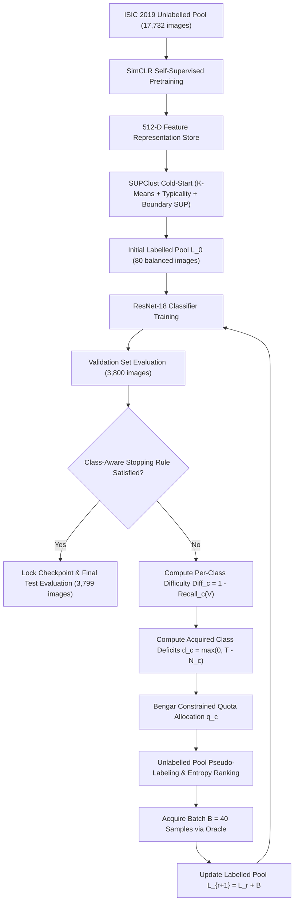

# CSDA-AL Research Methodology and Mathematical Formulations

**Document ID:** CSDA-AL-METH-001  
**Project:** Cold-Start Difficulty-Aware Active Learning on Imbalanced Medical Images (ISIC 2019)  
**Authors:** CSDA-AL Research Team  

---

## 1. Mathematical Framework & Problem Formulation

In pool-based active learning for long-tailed medical imaging, we are provided with:
1. A large unlabelled training pool $\mathcal{U} = \{x_1, x_2, \dots, x_N\}$ of dermatoscopic images sampled from an imbalanced diagnostic distribution $\mathcal{P}_{data}(X, Y)$.
2. A fixed closed set of $C=8$ diagnostic categories $\mathcal{Y} = \{\text{MEL}, \text{NV}, \text{BCC}, \text{AK}, \text{BKL}, \text{DF}, \text{VASC}, \text{SCC}\}$.
3. An initially empty or minimal labelled pool $\mathcal{L}_0 = \emptyset$.
4. An annotation oracle $\mathcal{O}$ that reveals the true diagnostic label $y_i = \mathcal{O}(x_i)$ at a unit annotation cost.
5. An active acquisition budget $B$ per round, running for $R$ rounds subject to a maximum label budget $B_{total} = B_0 + (R-1)B$.
6. A sequestered validation set $\mathcal{V}$ used strictly for model selection, class difficulty estimation, and stopping evaluation (zero data leakage into acquisition queries).
7. A sequestered held-out test set $\mathcal{T}_{test}$ locked cryptographically until final performance benchmarking.

---

## 2. Component Methodologies

### 2.1 Self-Supervised Cold-Start: SUPClust (Ono et al., ICLR 2024 Workshop)
When $\mathcal{L}_0 = \emptyset$, supervised classifiers cannot provide meaningful class predictions. To avoid majority-class dominance from random sampling, in-domain representations $z_i = f_\theta(x_i) \in \mathbb{R}^D$ are learned via SimCLR on $\mathcal{U}$ with NT-Xent loss:
$$\mathcal{L}_{\text{NT-Xent}} = -\log \frac{\exp(\text{sim}(z_{i,1}, z_{i,2}) / \tau)}{\sum_{k=1}^{2M} \mathbb{I}_{[k \neq i]} \exp(\text{sim}(z_{i,1}, z_k) / \tau)}$$

In the learned feature space, $K$ clusters are formed via K-Means ($K = B_0$):
$$\min_{\{\mu_k\}} \sum_{i=1}^N \min_{k \in \{1,\dots,K\}} \|z_i - \mu_k\|_2^2$$

For each unlabelled sample $x_i$, its **Typicality** measures local density within its assigned cluster $S_k$:
$$\text{Typicality}(x_i) = \frac{1}{\frac{1}{|N_k(x_i)|} \sum_{z_j \in N_k(x_i)} \|z_i - z_j\|_2}$$
where $N_k(x_i)$ denotes the $k$-nearest neighbors in cluster $S_k$.

The **Softmax Unsupervised Prediction (SUP)** score measures cluster boundary ambiguity:
$$p(c_k | x_i) = \frac{\exp(-\|z_i - \mu_k\|_2^2 / 2\sigma^2)}{\sum_{j=1}^K \exp(-\|z_i - \mu_j\|_2^2 / 2\sigma^2)}$$
$$\text{SUP}(x_i) = -\sum_{k=1}^K p(c_k | x_i) \log p(c_k | x_i)$$

The SUPClust composite acquisition score ranks candidates by:
$$S_{\text{SUPClust}}(x_i) = \text{Typicality}(x_i) \cdot \text{SUP}(x_i) \cdot \mathbb{I}[\text{cluster}(x_i) \notin \mathcal{C}_{\text{occupied}}]$$
This guarantees that the initial batch $\mathcal{L}_0$ samples diverse cluster boundaries while avoiding redundant majority-mode clustering.

---

### 2.2 Class-Balanced Active Learning: Bengar et al. (WACV 2022)
Conventional uncertainty sampling queries instances with maximal Shannon entropy:
$$H(x_i) = -\sum_{c=0}^{C-1} p(y=c | x_i) \log (p(y=c | x_i) + \epsilon)$$

On imbalanced visual datasets, high entropy predominantly occurs around majority-class decision boundaries, starving rare categories (e.g., DF, VASC, SCC).

Bengar et al. enforce class balance using pseudo-labels $\hat{y}_i = \arg\max_c p(y=c | x_i)$ and acquired class counts $N_c = |\{x \in \mathcal{L} : y(x) = c\}|$:

#### A. Constrained Quota Allocation (Primary):
Target representation per class: $T = \frac{|\mathcal{L}| + B}{C}$.  
Class representation deficit: $d_c = \max(0, T - N_c)$.  
Per-class acquisition quota:
$$q_c = \text{round}\left( B \cdot \frac{d_c}{\sum_{j=0}^{C-1} d_j} \right), \quad \text{s.t.} \quad \sum_{c=0}^{C-1} q_c = B$$
Within each pseudo-class bucket $\mathcal{U}_c = \{x_i \in \mathcal{U} : \hat{y}_i = c\}$, candidates are sorted by entropy descending:
$$\mathcal{Q}_c = \text{Top-}q_c\left( \arg\text{sort}_{x_i \in \mathcal{U}_c} (-H(x_i)) \right)$$
Underflow redistribution: If $|\mathcal{U}_c| < q_c$, the deficit is filled globally with the highest entropy candidates from remaining unselected pools.

#### B. Penalized Uncertainty (Ablation):
$$S_{\text{Bengar-Pen}}(x_i) = H(x_i) \cdot \left(\frac{1}{N_{\hat{y}_i} + 1}\right)^\beta, \quad \beta \ge 0$$

---

### 2.3 Flexible Curriculum Sampling: Ju et al. (MICCAI 2022)
Flexible Sampling dynamically prioritizes hard classes by tying acquisition quotas to validation performance:
Per-class learning difficulty is derived from validation recall:
$$\text{Diff}_c = 1 - \text{Recall}_c(\mathcal{V})$$
Normalized sampling probability:
$$p_c^{\text{flex}} = \frac{\text{Diff}_c}{\sum_{j=0}^{C-1} \text{Diff}_j}$$
Allocated quota: $q_c^{\text{flex}} = \text{round}(B \cdot p_c^{\text{flex}})$. Candidates within class $c$ are selected via BALD (Bayesian Active Learning by Disagreement) or predictive entropy:
$$\text{BALD}(x_i) = H\left( \frac{1}{T}\sum_{t=1}^T p_t(y | x_i) \right) - \frac{1}{T}\sum_{t=1}^T H(p_t(y | x_i))$$

---

### 2.4 Class-Aware Stopping Criterion (CSDA-AL)
Active learning terminates when minority classes achieve diagnostic stability, preventing futile majority-class over-annotation.

Let $R$ be the current round, $L_R$ the acquired training set, and $\mathcal{V}$ the validation set.
Termination triggers if and only if **all** of the following conditions hold:
1. **Minimum Class Representation:**
   $$\forall c \in \{0, \dots, C-1\}, \quad N_c(L_R) \ge k_{\min} \quad (k_{\min} = 2)$$
2. **Minimum Iteration Rounds:**
   $$R \ge R_{\min} \quad (R_{\min} = 3)$$
3. **Macro-F1 Plateau:**
   $$\text{MacroF1}(R) \le \max_{j < R} \text{MacroF1}(j) + \delta \quad \text{for } P \text{ consecutive rounds} \quad (P = 2, \delta = 0.005)$$
4. **Minority Recall Satiation:**
   $$\max_{c \in \text{Tail}} |\text{Recall}_c(R) - \text{Recall}_c(R-1)| \le \epsilon_{\text{tail}} \quad (\epsilon_{\text{tail}} = 0.01)$$

---

### 2.5 Active Label Refinement: Khanal et al. (MICCAI 2024)
For noisy dermatoscopic environments, dual ResNet-18 models ($f_{\theta_1}, f_{\theta_2}$) exchange small-loss instances via Co-teaching:
$$\mathcal{L}_{\text{peer}}^{(1)} = \frac{1}{|\mathcal{S}_2|} \sum_{i \in \mathcal{S}_2} \ell_{\text{CE}}(f_{\theta_1}(x_i), \tilde{y}_i), \quad \mathcal{S}_2 = \text{argmin-loss}_{R(t)}(f_{\theta_2})$$
Suspects with high prediction disagreement and high entropy are flagged:
$$\text{Suspect}(x_i) = \mathbb{I}[f_{\theta_1}(x_i) \neq \tilde{y}_i \lor f_{\theta_2}(x_i) \neq \tilde{y}_i] + H(\bar{p}(x_i))$$
The annotation oracle re-labels top suspects to restore ground-truth diagnostic purity.

---

## 3. The Proposed Unified CSDA-AL Pipeline (C4)

The unified CSDA-AL pipeline provides end-to-end immunity against class imbalance by combining representative cold-start initialization, dynamic difficulty weighting, constrained class-balancing quotas, and multi-metric early stopping.
